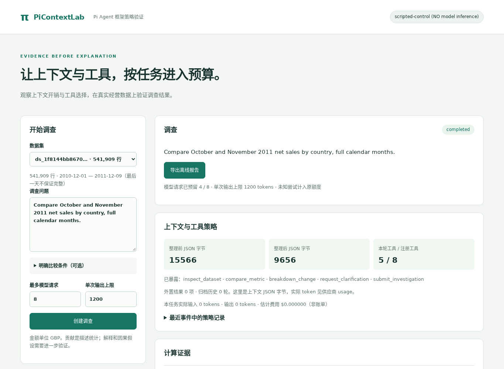

# PiContextLab

**Pi Agent Core 的上下文预算与工具选择改造**，使用 DeepSeek API 运行；附带可追溯经营指标调查客户端 PiMetricLab，用真实数据验证框架行为。

这项项目的主体是对固定 **Pi 1.6.0** 核心的 MIT 派生实现 `1.6.0-contextlab.12`，不是只换 prompt 或套 SDK。原始版本以独立 npm 别名保留作对照；尚未向上游提交或合入。

[岗位项目附件](examples/role-briefs/) · [项目说明与展示](docs/project-brief.md) · [独立SDK接入](docs/integration.md) · [完整中文讲解](docs/handbook.md) · [框架改动与算法](docs/framework.md) · [实验结果](docs/validation.md) · [DeepSeek 接入](docs/deepseek.md) · [简历与面试](docs/resume.md) · [研究来源](docs/references.md)

## 核心改进

| 改动 | 实际行为 |
|---|---|
| 原生 `ModelContextPolicy` | 在规范化 transcript 后生成本轮 provider 视图及执行白名单；核心验证声明与注册工具对象一致 |
| 预算化工具选择 | BM25 词法排名、依赖闭包、工具数量/schema 字节双预算；显式发现漏选工具；支持完整目录文档和有界索引复用 |
| 可回查上下文 | 路由后超预算才按大小外置可节省字节的结果，支持多个中等结果的累计压力，满足预算即停止；最近并行回读整批保留，完整旧 user turn 打包，权威历史不裁剪 |
| 精确子树保留 | 可选地按当前问题选择完整JSON子树，保留数值字面和路径；基础打包后按实际剩余空间与双层增量预算加入，默认关闭 |
| 字段定位 | 可选的有界 JSON 叶字段词法检索，返回合法 pointer 与来源预览；无额外模型调用 |
| 批量精确 recall | 会话范围、完整性检查、最多 8 个 RFC6901 路径、总计最多 4,096 Unicode code points；逐字段返回可直接使用的 `next_read` 续读参数 |
| 共享回读预算 | 可选地为同一 assistant 批次的读取/定位分配总内容字节预算，串行、并行与恢复使用相同分配；精确分页或明确延后 |
| 按剩余空间分配 | 完整响应返回后、纯回读批次执行前，投影完整工具事务并收紧预算；保存与响应绑定的配额，恢复时复用 |
| 有界校验反馈 | 可选2KiB schema拒绝提示，保留字段诊断/长度，完整assistant输入不改；业务正常与恢复均开启 |
| 请求审计与恢复 | 宿主将工具集合与请求预留、具体响应身份绑定；恢复按该响应查集合，未知调用仍占额度 |
| 宿主结构化封存门槛 | 在写入事务内将数值/方向/贡献组/勾稽与任务证据核对，成功记录核对范围；解释与人工审核分开 |

上游已有压缩、持久化 Harness 和工具执行能力。本项目的贡献是 core 层的策略入口、预算组合及声明/执行一致性；BM25、哈希外置和持久化思想均不声称原创。

## 真实验证客户端

PiMetricLab 完成“订单明细 → 明确口径 → 期间比较 → 国家/商品贡献 → SQL 证据 → 封存报告”。支持六种指标，使用 DuckDB DECIMAL 和 BigInt；没有任意 SQL、shell 或审核工具。未明确指标/期间时仅暴露检查与澄清工具，避免模型自行猜测。

完整 [UCI Online Retail](https://archive.ics.uci.edu/dataset/352/online+retail) **541,909 行**入库，直接从原 Excel 读取的独立 Decimal/set 程序核对 **12 个指标值、29 个国家分组及质量计数**。数据属 Daqing Chen (2015)，[DOI](https://doi.org/10.24432/C5BW33)，CC BY 4.0；原始数据不入库 Git。



## 运行

Node **22.19+**（实测 22.23.5）。本次所有安装、构建、测试、浏览器和推理均在授权服务器执行，未使用 GPU。

```bash
npm ci --ignore-scripts --no-audit --no-fund
npm run check
npm run build
npm test
```

显式下载 [原始 ZIP](https://archive.ics.uci.edu/static/public/352/online+retail.zip)，在独立 Python 环境安装 `openpyxl==3.1.5`、`et-xmlfile==2.0.0`：

```bash
python scripts/prepare_uci.py --archive /path/to/online-retail.zip --output /path/to/retail-data
node dist/src/cli.js ingest /path/to/retail-data/transactions.csv /path/to/retail-data/source-manifest.json
export DEEPSEEK_API_KEY='YOUR_KEY'
export METRICLAB_MODEL_URL=https://api.deepseek.com
export METRICLAB_MODEL_ID=deepseek-flash
export METRICLAB_MAX_CONTEXT_BYTES=65536
export METRICLAB_CONTEXT_POLICY=upstream
export METRICLAB_ARTIFACT_SEARCH=0
npm start
```

打开 `http://127.0.0.1:4318`，在“明确比较条件”里选择指标及四个边界日期。例如净销售额：基期 `[2011-10-01,2011-11-01)`，本期 `[2011-11-01,2011-12-01)`，完整自然月；问题填写“比较以上期间，按 country 拆解变化并提交报告”。不填条件时先澄清。CLI 也可使用四个 ISO 日期、准确指标 token 及 `calendar_month`/`equal_days` 的显式问题。

真实 API 入口默认使用完整上下文，超过配置上限时在发送前拒绝。预算化策略与字段定位需要显式开启，配置见 [DeepSeek 接入](docs/deepseek.md)。

Pi 运行时直接调用官方 DeepSeek API，显式关闭 thinking、内部自动重试为 0，无需显卡或本地权重。未配密钥时为检查模式。无需推理的工程演示：

```bash
node dist/src/cli.js serve --scripted-control
```

页面明确标注 `scripted-control`，固定十月/十一月调查，不代表模型效果。

## 如何看结果

最新宿主通过 **101 项工程测试、14 项浏览器检查和全量数据核对**。修复了超过 500 条事件后可能用错恢复工具集合的问题；同一合成反例中，未允许的查询证据由修复前 1 条变为修复后 0 条，见 [恢复对照](evidence/request-binding/)。

公开 ToolRet API-Bank 的 101 条查询对 37,292 个工具检索中，字段化词法方案 Recall@10 **20.13%**，低于完整文档基线 **30.94%**。早期上下文方案也出现把存储 ID 当报告 ID、过多分页而耗尽额度的失败。原始结果保留，后续修订使用新用例单独记录，不能把字节减少写成成功率提升。

v6 在37,292工具的固定CPU负载上，将路由中位耗时从991ms降至433ms（每变体16次，含缓存冷启动），配对输出完全一致；这是路由开销，见 [原始对照](evidence/routing-cache/)。

v5 完成按压力触发、整批回读保护及续读参数的 CPU 对照，未追加模型请求，见 [机制对照](evidence/context-pressure/)。

v4 新报告的真实 DeepSeek 审计中，完整上下文2/2通过，两种预算策略均0/2；因此它们保持实验性。研究已关闭，不重复挑分，见 [运行前方案](docs/evaluation-v4-plan.md)及 [完整原记录](evidence/api-v4/)。

core6 的两个新业务任务在完整/预算配置下均完成，共12次真实DeepSeek请求；两项预算任务均未触发外置或回读，只证明低压力集成，见 [原始记录](evidence/business-v6/)。

core7 修复了多个低于单条阈值的结果累积超限却无法外置的缺陷；同一真实数据脚本复盘从预算拒绝变为完成。新的真实压力对照中两个分支都失败，已保留 [全部记录](evidence/pressure-business/)；不把机制修复写成模型成功率提升。

core9 在新 CPU 对照中，把同一批四次源码回读的内容 JSON 从31,262字节限制为8,187字节，保留精确续读参数；这是更短的分页响应，未证明模型成功率或 token 收益，也未保证整个下一轮上下文可容纳，见 [原始对照](evidence/recall-budget/)。

core10增加响应后的纯回读空间规划：新合成压力控制中，静态版回读后超限终止，规划版按实际剩余量收紧配额后可继续；空间极端不足时执行前拒绝。宿主先持久保存与响应绑定的方案，再开始工具，恢复沿用原方案。仅证明指定程序机制，见 [原始对照](evidence/result-headroom/)。

core11在新的结构化业务预检中修复回退目标未留最低内容空间的问题，增加有界可行目标搜索与紧预算回读元数据。原core10两个预算控制失败；任务和20KiB预算不变后四个脚本控制均通过。随后按先行源码实际执行16次DeepSeek请求：完整配置两项事实核对通过，预算配置两项均未通过（一项回读前拒绝，另一项封存了错误贡献值）；脚本可行性没有转化为模型压力成功，见 [全部原记录](evidence/structured-brief/)。

随后新增客户端封存前来源校验：两个正确的历史声明体可继续封存，那份错误贡献体被阻断且未写入成功缓存，校验范围绑定报告身份并在导出中标明。这是应用约束的CPU回归，不是模型准确率提升或重新改分，见 [原始回归](evidence/brief-proof/)。

[实验记录](docs/validation.md) 区分工程控制、公开检索、真实 API 小样本和独立金额核对。当前不声称 SOTA、新模型训练、生产用户、普遍准确率提升或无损完成所有任务。

当前为可信本机/内网的单租户工作台，不提供公网鉴权或多租户隔离。报告解释标记待核实，贡献分析不证明因果。个人主页保持冻结。

项目采用 MIT；派生核心保留 [上游来源与文件哈希](vendor/pi-agent-core/UPSTREAM.json)、[原许可](vendor/pi-agent-core/LICENSE) 和 [可移植源码补丁](patches/)。精确依赖见 [package-lock.json](package-lock.json)。

core12增加默认关闭的查询相关精确子树保留，完整原文仍可回查、审计历史不改。新的集中度预检因没有压力而关闭，未改预算重跑；另一个固定部署锁文件工作负载的四个CPU原生Agent控制通过，开启保留仍各需一次回读，不据此宣称模型收益。先行[新方案](examples/dependency-audit-protocol.json)与[全部预检证据](evidence/exact-retention/)公开后才运行真实API。

该先行方案随后实际执行12次DeepSeek请求：开/关各两项均核对正确，每项3请求/1回读；DuckDB开启时回读路径3条缩到1条，但输入token总体更多，没有请求或效率收益。173个执行输入与先行提交一致，原始轨迹及[独立来源检查](evidence/exact-retention/study/independent-source-check.json)公开；研究关闭，不追加余量重试。

## 独立SDK产物

派生核心现在有[已验证tarball](evidence/sdk-distribution/earendil-works-pi-agent-core-1.6.0-contextlab.12.tgz)。补齐包内声明映射所需的17个源码文件后，在仓库外完成独立安装、`skipLibCheck=false`的类型检查和真实Pi Agent脚本集成控制；没有新增模型调用。许可、固定上游身份、哈希、消费lock及原始失败均见[分发证据](evidence/sdk-distribution/)。按[接入说明](docs/integration.md)使用，或先读[简明项目说明与十分钟展示](docs/project-brief.md)。
