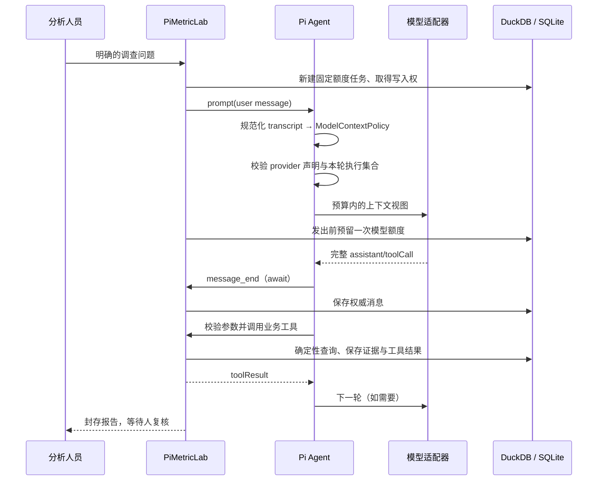
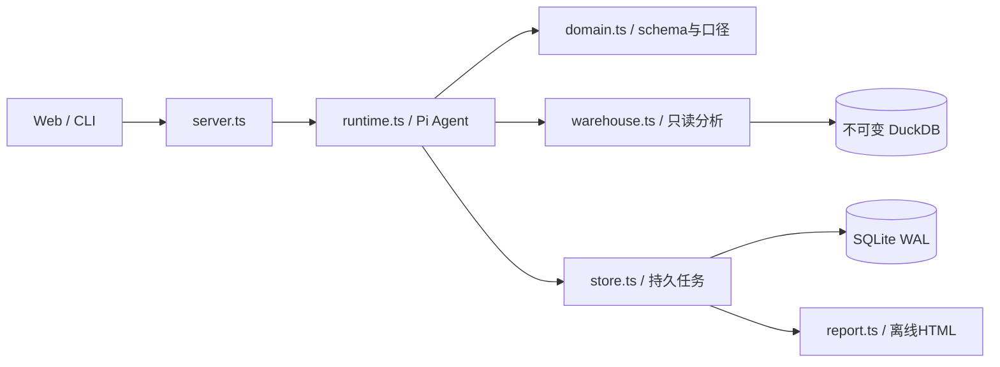

# 从 Pi 到 PiContextLab：框架改造与验证客户端完整讲解

本文对应官方 Pi **1.6.0**、派生核心 **1.6.0-contextlab.6** 与本仓库代码。框架改进是主线，PiMetricLab 经营指标应用是验证客户端。建议按“先跑一个报告，再读架构和恢复，最后看源码”的顺序学习。上游身份见 [upstream-lock.json](../upstream-lock.json)，研究来由见 [references.md](references.md)，实际运行证据见 [validation.md](validation.md)。

## 1. 项目要解决的具体问题

分析人员发现某月销售指标变化，往往需要先回答一串基础问题：销售额指净额还是正向销售？退款怎样处理？这个月数据完整吗？订单数是不是按明细行数算错了？变化主要来自哪个国家、哪些商品？另一个人能不能重现这份报告？

PiMetricLab 把这条调查流程做成一个可执行的工作单元。输入是有来源清单的订单 CSV 和明确的调查问题；输出是一份带确定性结果、SQL、参数、数据版本、口径版本和哈希的封存报告。模型解释和待验证假设单独展示。人工复核属于人的操作，模型没有审批工具。

本版服务于公开历史数据与单租户本机分析。它没有生产客户或商业落地证明，也没有把统计贡献解释为因果。项目的可信度来自可运行代码和可核对证据。

## 2. Pi 究竟是什么

用户所指的 Pi 是 [earendil-works/pi](https://github.com/earendil-works/pi)，此前使用 `badlogic/pi-mono` 仓库名。它包含多个可以分层使用的包，而不只是一个聊天命令行。

| 层 | 本项目怎样理解 | 本项目是否使用 |
|---|---|---|
| `pi-ai` | 模型类型、消息和流式事件协议、供应商适配器 | 使用固定 OpenAI-compatible adapter |
| `pi-agent-core` | Agent 状态、轮次调度、工具调用、事件与取消 | 核心依赖，真实运行 |
| `pi-schema` | 工具输入 schema 与边界验证 | 工具及 HTTP 输入 |
| coding agent | 面向编程工作的高层宿主、会话、终端与扩展机制 | 作为研究背景，不把编程工具暴露给业务 Agent |

为什么不用 coding agent CLI 加一个 prompt 就结束？电商分析需要自己的指标口径、数据库边界、额度、报告身份和复核流程。给业务 Agent 任意 bash 或 SQL 能力，会让正确性和权限检查变得更难。本项目选择 core 层构建领域宿主。

原始研究克隆未修改；本项目在 `vendor/pi-agent-core` 中派生 core，新增请求级上下文与执行工具策略。上游已有 pi-durable、压缩及工具限制，不把这些既有能力当作本项目原创。Pi 的 MIT 许可原文保存在 [第三方许可](../THIRD_PARTY_NOTICES/pi-MIT.txt)。

## 3. 最重要的运行时数据结构

`Model` 描述模型 ID、API 类型、provider、base URL、输入模态、上下文容量和输出上限。本项目通过官方 DeepSeek API 调用模型，不部署或下载本地权重。远程模型密钥留在后端环境，不能放入网页或 Git。

`AgentMessage` 是对话记录，主要包括 system、user、assistant 和 toolResult。assistant 的内容可能是文字，也可能包含一个或多个带 ID 的 toolCall。toolResult 通过 `toolCallId` 对回原始调用。

`AgentTool` 把以下内容放在一起：工具名、业务描述、参数 schema、显示标签和执行函数。执行函数返回 `content` 和结构化 `details`，可以指示错误或结束自动循环。工具名和 JSON 参数不是可信执行权限；业务侧仍要检查日期、指标、版本和归属。

`StreamFn` 返回 Pi 的 assistant 事件流，而不是一段最终字符串。provider 可能逐步发出文字与工具参数，最终才形成完整 assistant 消息。因此不能在收到半截工具参数时执行查询。

Pi 1.6 的构造参数是 `streamFn`；实例属性叫 `streamFunction`。网上较新的 main 文档可能存在命名差异，必须对照固定版本。参数与模型声明在规范化后的 system transcript 中传给 provider，不能假定最终 provider context 仍有独立的 `tools` 字段。

## 4. 一轮 Agent 怎样真正发生

正常路径可按以下顺序理解：



这里最关键的是 `message_end` 的持久化屏障：1.6 的 Agent 先把完成消息加入 state，再等待订阅者。本项目在订阅者里提交 SQLite；该操作完成之后才允许后续工具执行。因此进程如果在工具开始前死亡，仍然能知道模型究竟发出了哪些完整调用。

`agent_end` 只是最后一个事件；所有被等待的订阅者完成后才真正 idle。代码用 `waitForIdle()` 等待收尾，不能只看最后一条文字。

Agent 的 `prompt()` 在已有活动任务时不能重复调用。`steer()` 与 `followUp()` 是内存队列，不能天然当作持久消息队列。本项目没有把这些队列包装成虚假的可靠调度。

## 5. 三个容易误解的 Pi 行为

第一，`replay: 'safe'` 是工具声明，不会自动提供持久化、额度账本或 exactly-once。那些由宿主实现。

第二，`continue()` 不能直接接在最后一条 assistant 消息后面，即使 assistant 带有尚未处理的 toolCall。恢复时必须先补齐或对账工具结果，再继续模型调用。本项目用 Pi 导出的 `runToolCall()` 走同一套 schema 和执行流程，避免另写一套工具解释器。

第三，一批工具调用中只有所有结果都 `terminate: true`，核心才按这项提示结束自动工具循环。因此宿主还设置 `finishTurn`：已封存报告或已经请求澄清时结束当前调查。普通工具不会无条件要求下一轮，避免无限循环。

此外，Pi 会把某些运行时失败表示为 assistant 的 `error/aborted` 消息，`prompt()` 的 promise 并不必然抛出错误。宿主必须检查最终消息和状态。输出被 token 上限截断时，Pi 不会把可能不完整的参数当作完整工具调用执行。

## 6. 本项目的模块边界



| 文件 | 应重点读的部分 |
|---|---|
| [domain.ts](../src/domain.ts) | 关闭额外字段的 schema、日期语义检查、定点金额、稳定哈希 |
| [warehouse.ts](../src/warehouse.ts) | CSV 入库、实际质量、白名单 SQL 编译、贡献核对 |
| [store.ts](../src/store.ts) | 任务归属、模型额度、工具缓存、证据、封存和审核 |
| [runtime.ts](../src/runtime.ts) | 真实 Pi Agent、持久流、工具声明、恢复路径 |
| [server.ts](../src/server.ts) | HTTP 边界、SSE、读取和变更接口 |
| [report.ts](../src/report.ts) | 内容转义和无外部资源的 HTML 导出 |
| [demo.ts](../src/demo.ts) | 明确标注的脚本 provider，只做控制验证 |

领域工具为 `inspect_dataset`、`compare_metric`、`breakdown_change`、`request_clarification`、`submit_investigation`。没有任意 SQL、文件系统、网络搜索、命令执行或审批工具。

## 7. 数据身份与入库

数据来源是 [UCI Online Retail](https://archive.ics.uci.edu/dataset/352/online+retail)，作者 Daqing Chen (2015)，DOI `10.24432/C5BW33`，CC BY 4.0。官方文件包含 541,909 条交易明细，时间为 2010-12-01 至 2011-12-09，UnitPrice 币种为 GBP。

转换脚本 [prepare_uci.py](../scripts/prepare_uci.py) 显式读取原 ZIP，检查其中只有预期工作簿、字段与工作表，逐行输出 CSV，保留原工作簿行号。它不去重、不删除退款、不把缺失客户变成真实客户，也不把源时间强行解释为 UTC。

原 ZIP、原 Excel、CSV 各有 SHA256。CSV 的 SHA 决定 `ds_...` 身份；入库前核对来源清单，入库后再次计算文件哈希，检查导入过程中源文件没有变化。DuckDB 放到临时目录构建，检查通过后再把目录整体发布为新数据集。

CSV 入库会拒绝超过四位小数的价格，避免 DECIMAL cast 静默舍入。数量、原始行号、必填订单/商品字段也检查。独立的原始行号唯一性检查防止把同一源行重复塞进一次导入；源文件中真实重复的业务内容仍保留，不能擅自当作脏数据删除。

数据集质量以实际执行为准。完整数据实测：客户缺失 135,080 行，描述缺失 1,454 行，非正价格 2,517 行，负数量 10,624 行。数据卡和实际文件可能表达不同，不能用网页标签替代检查。

## 8. 指标口径与精确算术

共同的有效金额条件是 `unit_price > 0`，同时排除取消订单号却有非负数量的矛盾行。取消订单号按不区分大小写的 C 前缀识别。所有定义属于 `retail-gbp-v1`，不会把“净销售额”叫作“已收款”。

| 指标 | 具体计算 | 容易出错的点 |
|---|---|---|
| net_sales | 有效行的带符号数量 × 单价之和 | 负数量应减少净额 |
| gross_sales | 非取消、正数量有效销售行金额之和 | 不能把退款绝对值再加进来 |
| returns | 有效负数量行金额的相反数 | 这里是金额绝对值，不是订单退款率 |
| sales_orders | 有有效正向销售的 distinct invoice_no | 明细行数不是订单数 |
| identified_customers | 正向销售的 distinct 非空客户 ID | 未知客户仍贡献金额，但不冒充一个独立客户 |
| avg_order_value | gross_sales / sales_orders | 不是“平均明细单价”，无订单时为 null |

DuckDB 单价为 `DECIMAL(18,4)`，聚合保留定点精度，再以字符串返回 Node。Node 将十进制转成 `BigInt` 的万分单位，做差值、贡献合并与比值舍入。禁止在金额中间结果使用 `parseFloat`、JS `number` 或二进制浮点累计。

例如 `0.1 + 0.2` 的金额路径是 `1000n + 2000n`，再格式化为 `0.3000`。客单价四位小数使用半数远离零舍入，零分母返回 null。某些订单数差值也以统一四位定点字符串显示；单位字段仍明确为 count。

原数据可能包含手工调整或非普通商品行。本版不擅自猜测商品代码的会计意义，口径中明确保留这些来源内容。因此它是复现良好的经营分析定义，不是企业财务系统的法定会计定义。

## 9. 可比期间与贡献拆解

日期格式必须是实际存在的 `YYYY-MM-DD`。期间采用左闭右开 `[start,end)`，不重叠且基期在前；单段最多 366 天。

支持两种明确的比较口径：`equal_days` 要求两段天数一致；`calendar_month` 要求每段恰好为一个完整日历月。完整月可能有不同天数，报告解释必须考虑自然月长度、星期分布和季节性，不能直接把总量变化叫作经营异常。

数据末端只有 2011-12-09 12:50，系统保守地不把最后观测日期视为完整一天。请求完整 12 月会被拒绝。只知道观测起止时间也不能证明中间没有漏日；本版检查的是边界覆盖，不是完整的数据采集 SLA。

国家或商品拆解只开放给可加和的三个金额指标。每个分组算 `current - baseline`，按绝对贡献排序，Top N 之外聚合成 OTHER。真正的 NULL 国家仍是 NULL，与文字 `OTHER` 或 `Unknown` 不混为一谈。

订单和客户跨商品分组时会重复，不能把各组 distinct count 相加当总数；平均值同样不具有这种可加性。此类请求直接拒绝。

封存报告时，贡献证据必须找到相同指标、相同期间、相同比较口径的 comparison；贡献的基期、本期和差值均须与 comparison 一致。这能防止把“净销售额比较”配上一份“正向销售额贡献图”。

## 10. 证据和报告的身份

每条证据保存：dataset、policy、请求、SQL、参数、查询原始结果、确定性结果，以及结果 SHA256。证据 ID 对整个内容作稳定哈希；对象键顺序不影响身份，数组顺序仍保留。

模型看到简洁的工具结果和证据 ID，不能通过报告工具上传任意数字表。报告工具只接受标题、已有证据引用、解释和假设；数字事实由引用的证据生成。封存前检查引用存在、数据/口径版本正确、结果校验和正确、证据内容身份正确。

解释区仍然是模型生成内容，不能自动认定其中每一句都真实。界面明确标注“待核实”，并把确定性数字放在独立证据区。这里没有声称实现全自然语言事实校验。

报告 ID 对调查内容计算哈希；同一内容重复封存返回同一版本，改变内容则拒绝覆盖。审核需要报告 ID、明确决定和人的文字意见，只通过单独 HTTP 路由提交。模型工具表中没有审核操作。

离线导出使用 HTML 转义，包含口径、请求、结果、SQL、参数、哈希与审核快照。没有远程脚本、字体或图表依赖，下载后能独立阅读。封存报告与后续审核是两个不同对象，旧导出不会自动变成已审核版本。

## 11. 持久任务、写入归属与固定额度

SQLite 使用 WAL、`synchronous=FULL` 和短事务。任务状态包括 queued、running、paused、clarification、completed、failed、cancelled；Web 刷新后从服务器重读记录，而不是依靠浏览器保存完整工作状态。

任务由一个随机 owner 和递增 epoch 认领，租约 15 秒，活动运行每 2 秒续约。每次权威写入检查 owner、epoch、租约与取消标志。旧进程即使恢复执行，也不能在新 owner 认领后提交结果。这是单主机 SQLite 上的写入防护，不等于多地域分布式协调。

模型每次发出前先预留一个请求槽。完成回复存入账本后才交给 Pi 的完成事件；同一请求上下文的成功回复可以复用。进程死亡时仍为 pending 的尝试转 unknown，继续计入原额度，不假定供应商没有处理。

额度是最大请求数和单次输出 token 上限，不是精确货币账单。provider 内部重试明确设为 0，完整响应默认有 90 秒 deadline（可显式配置为 1–300 秒并绑定任务）；HTTP 503 控制验证确认适配器只发一次请求。失败/中断的回复不会伪装成成功缓存。

恢复时还绑定模型配置、Pi 版本、口径、prompt 版本和工具 schema 指纹。模型或工具定义变化时应新建调查，不应悄悄把旧任务当作相同实验继续。

## 12. 崩溃恢复究竟保证了什么

本版验证了以下关键中断点：

1. 完整 assistant/toolCall 已持久化，工具尚未执行，进程被 SIGKILL。
2. 只读查询结果及工具缓存已提交，Pi 的 toolResult 消息尚未追加，进程被 SIGKILL。

新 owner 等旧租约过期后认领，检查最后一批 assistant 调用，并按该保存响应的内容身份读取生成请求的工具集合；不从最新事件或事件分页推测。已有 toolResult 的跳过；有相同 call ID 与参数哈希的工具缓存则复用；尚未执行的只读查询经 Pi `runToolCall` 校验后执行。每补一条工具结果就提交消息，然后调用 `continue()`。

工具结果和查询证据在同一事务保存。只读查询若在计算中途死亡，可重算；报告写入有内容身份和单任务唯一性，即使在工具结果提交前死亡，也不会生成第二份不同的封存报告。

`SIGTERM` 正常停服会中断活动请求并把任务暂停；明确的取消会写入不可继续的 cancel 标志。一个被截断或主动中止的 assistant 不执行工具，恢复时可丢弃这条不完整消息，同时保留已计入额度的原始尝试。

没有验证外部支付、邮件或第三方写操作的 exactly-once。本项目根本不提供此类工具。宿主硬件损坏、SQLite 文件被外部改写、文件系统不满足其持久性语义，也不在两种进程崩溃测试的保证范围内。

## 13. Web 和 API 怎样使用

默认监听 `127.0.0.1:4318`。左侧选数据集、查看覆盖范围和输入问题；右侧展示任务状态、请求额度、工具事件、证据和报告。SSE 事件从 SQLite 按递增 seq 读取，支持 Last-Event-ID；浏览器 localStorage 仅记住选中的任务 ID。

主要接口：

| 请求 | 作用 |
|---|---|
| `GET /api/overview` | 数据集、口径、最近任务及运行模式 |
| `POST /api/jobs` | 创建固定额度调查 |
| `GET /api/jobs/:id` | 权威快照、证据、账本、报告和审核 |
| `GET /api/jobs/:id/events` | 可按 cursor 续读的 SSE |
| `POST /api/jobs/:id/resume` | 显式恢复可恢复任务 |
| `POST /api/jobs/:id/cancel` | 持久取消 |
| `POST /api/jobs/:id/review` | 人工提交具体版本的审核 |
| `GET /api/jobs/:id/export` | 自包含离线 HTML |

HTTP 输入有 JSON schema、大小上限、Host 与跨源写检查。前端用户内容通过 `textContent` 插入，导出单独转义。SSE 为执行事件而非可靠工作队列；事件查看不触发模型或重新运行任务。

这不是公网多租户产品。没有账号认证和细粒度角色，可信本机用户可以操作自己的数据。若部署到公网，需要反向代理鉴权、权限模型、审计主体、密钥管理、配额和租户隔离等完整设计，不能只改监听地址就声称已生产化。

澄清状态会展示模型提出的问题，本版让分析人员明确补全信息后新建调查，保留旧记录。它没有把上下文变化偷偷续进原实验，也未实现跨会话复杂工作流。

## 14. 从零复现

先按 [README](../README.md) 安装锁定依赖和转换数据，所有执行都放在授权服务器。Node 实测为 22.23.5，SQLite 属于该版本的实验 API，运行可能打印提示。

```bash
npm ci --ignore-scripts --no-audit --no-fund
npm run check
npm run build
npm test
python scripts/prepare_uci.py --archive /path/to/online-retail.zip --output /path/to/retail-data
node dist/src/cli.js ingest /path/to/retail-data/transactions.csv /path/to/retail-data/source-manifest.json
```

CLI 调查可把问题保存到 UTF-8 文件：

```bash
node dist/src/cli.js run ds_YOUR_DATASET_ID /path/to/question.txt
```

真实运行配置见 [DeepSeek 接入](deepseek.md)，密钥仅在后端环境。未配置 provider 时启动的网页只用于检查历史数据和报告。`--scripted-control` 固定十月/十一月任务，只验证工程路径；不能拿它给任意问题作看似真实的回答。

完整数据独立核对：

```bash
python scripts/oracle_uci.py /path/to/retail-data/original.xlsx /path/to/oracle.json
node dist/scripts/validate-uci.js /path/to/retail-data /path/to/oracle.json /path/to/new-validation
```

上面的 Python 程序直接从原 Excel 逐行用 Decimal 与 set 算结果，不导入 TS SQL 编译器。两个实现使用同一公开口径，但实现路径独立；只把编译器生成的 SQL 再算一遍不能叫独立 oracle。

## 15. 怎么验证，而不是怎样堆测试数量

验证分四层。第一层用小型人工可算夹具检查退货、浮点陷阱、订单粒度、空国家、OTHER 和精度拒绝。第二层使用真实 Pi 加脚本 provider，检查消息顺序、持久化、取消、恢复、封存和审核边界。第三层用完整真实数据与独立原工作簿计算交叉核对。第四层才是真实模型的有限演示和浏览器操作。

模型输出是否调用正确工具、是否需要澄清、是否封存报告，与金额引擎算得是否正确是两组不同问题。模型没完成，不会被脚本结果顶替；一两个用例完成，也不能声称高准确率或业务 ROI。

两种 SIGKILL 测试实际启动子进程；为了让测试不等待 15 秒，测试代码显式将死进程租约置过期，生产路径则等待实际租约。测试中的人工审核路由只作用于合成夹具并写明 TEST，不等于给真实报告代做人工审批。

## 16. 遇到过的部署问题

首次 Node 导入探针成功，但外层脚本误把末尾 SQLite 提示当作 JSON。修复的是日志读取，安装产物复用，没有把失败运行删掉。

更值得讨论的是 DuckDB 2.0 的线程问题。只设置 `threads=2` 时，独立 async I/O 线程池仍创建大量线程；探针实测 223 线程、虚拟地址接近 16 GiB，随后分配失败，RSS 只有约 120 MB。参照 [官方配置](https://duckdb.org/docs/stable/configuration/overview)，同时设置 `async_threads=2` 后，探针为 14 个进程线程，虚拟地址约 1.6 GiB，原有 16 GiB 地址上限内查询成功。

这解释了为什么“内存不足”不能只看数据大小或把上限随便增大。需要区分地址空间、线程栈、常驻内存、数据库预算和模型权重。浏览器也有较大的虚拟地址预留需求，浏览器验证与普通 CPU 测试使用不同地址空间约束，但仍限制实际 RSS、CPU 和总时长。

真实模型加载与请求记录另见 [validation.md](validation.md)。所有早期失败和实际资源观测保留，不把模型加载失败叫作推理成功。

## 17. 如何在面试中讲清楚贡献

建议先讲用户任务，再讲具体难点：一个分析人员调查销售额变化，系统必须处理退款、缺失客户、时间覆盖和分组核对。然后解释 Pi 与宿主的分工，重点讲“完整消息落盘之后才允许执行工具”和“未知调用不返还额度”这两个决策。

展示材料应包含：一份离线报告、一段可核对 SQL、六指标独立 oracle、真实 SIGKILL 恢复记录，以及真实模型演示的原始结果。不要只放一张聊天截图，也不要把 Pi 自带能力全部写成自己的原创算法。

面向算法与模型研发，可重点讲上下文打包、预算化工具检索、框架接口、对照设计及负结果分析；面向 Agent 应用开发，补充确定性业务闭环、持久化与 Web 交付。当前没有新模型训练或可信的普遍成功率提升结论。

简历可用措辞及禁止夸大的内容见 [resume.md](resume.md)。后续研究计划不计入已完成成果。

## 18. 下一阶段有哪些有价值的扩展

优先级最高的是实际分析人员使用反馈：哪些问题需要澄清、哪些指标口径经常改、哪类报告需要回查、当前数据导入是否适合他们的工作流。再据此补充可验证能力。

可形成算法研究的方向包括：澄清与直接执行的决策、错误工具反馈后的纠正、面向数据覆盖的拒答校准、查询成本下的调查策略。评估需用提前冻结的任务、独立标注、明确失败类别和固定预算，避免只挑成功案例。

工程方向可扩展到来源适配器、指标版本迁移、严格的用户身份、协作复核和有审计主体的权限系统。只有出现多个独立调查子任务时才引入多 Agent；只有需要跨主机长时间任务时才考虑 Temporal 等基础设施。

这些是路线图，不是当前已经实现的功能。个人主页保持冻结，不会自动把路线图当作完成项目发布。

## 19. 本次如何改到框架内部

请先读 [框架说明](framework.md)，再按 `model-context.ts → agent.ts → agent-loop.ts → budgeted-policy.ts` 读代码。

原版的 `transformContext` 可以变更传给模型的消息，但应用侧裁剪 schema 不会天然改变核心执行注册表。本项目新增可选 `ModelContextPolicy`：`prepare({context, tools, model})` 返回 `{context, tools}`，core 逐项验证工具来自注册表、名称唯一、声明与对象一致。当前 assistant 的执行只使用这个集合。未选中的工具调用返回错误，不会碰执行函数。关闭策略时保留原版路径。

同一 policy 实例只属于一个 Agent。工具发现和原文读取是正常注册工具，同样经过 schema 校验；策略缩小集合不替代宿主权限。恢复时宿主还原已保存的工具选择，不能根据重启后的排名重新解释上一轮。

## 20. 工具检索的计算与预算

输入仅使用当前 user 问题；工具文本可为名称、描述、参数，或 `routingDocuments` 提供的完整原文。NFKC 归一化后提取英文数字词和中文二元字符；BM25 固定 `k1=1.2,b=0.75`，没有训练或隐藏模型请求。

设工具排名为 s(t)，schema 成本为 c(t)。实现先加入必选工具及其递归依赖，然后按 s(t) 顺序贪心加入能同时满足 `工具数≤K` 与 `Σc(t)≤B` 的完整依赖组。不是最优背包算法。依赖缺失、必选组超预算直接失败。漏选时模型调用 `discover_tools`，候选记录持久化在 toolResult；下一轮从最近两个 assistant 轮次重放提升候选，而不是只放在内存。

公开评测显示裁剪到字段会丢失有用目录信息，低于完整文档基线。这推动接口支持保留完整文档，但不回跑同一标签集制造改进分数。早期 core 每次重建索引；contextlab.6 将有界索引复用接入原生策略，使用实际元数据逐字符串核对失效，详见第27章。

## 21. 上下文打包怎样保持可追溯

先验证 assistant 工具批次有且仅有对应结果；保留全部 system 指令，去掉仅用于显示的 details。contextlab.5 先路由工具并测量规范化 provider 视图；只有超预算才把超过阈值的较大文本结果按精确 UTF-8 字节哈希外置，达到预算即停止。最近一个并行工具批次中的所有回读/搜索结果一起保护。外置时替换成来源工具、SHA256、字节数、root keys 和最多 512 字节的精确身份字段。`ctx_` 只是存储句柄，不能当 report ID。

若仍超过预算，旧 user turn 按 `(BM25相关性 + 0.15×新近性)/sqrt(该轮字节数)` 排序尝试装入，保留原始时间顺序；当前用户轮及已完成工具回合整体保留。旧轮原文和索引也有内容身份。强制部分仍超预算时拒绝，不截断工具事务或用户要求。

`read_context_artifact` 一次接受最多 8 个 JSON pointer。依次读取共享的最多 4,096 code points，超长值逐字段返回 `has_more`、实际返回 code points、`next_offset` 和可直接传回的 `next_read`；读取先验证会话归属、哈希与长度。它返回精确原文，不做另一次 LLM 摘要。存储无损不等于推理无损：模型仍可能找错路径、读错身份或耗尽请求额度。

## 22. 怎样复现框架评测

`npm test` 包含原始 npm Agent 与 fork 的未选择工具执行对照、完整工具事务、系统指令、身份提取、Unicode 批量读取及发现恢复。控制用例只证明协议与程序边界。

公开工具目录实验见 `examples/toolret-protocol.json`，冻结文件哈希和版本后用 `fetch_toolret.py → extract-toolret.mjs → normalize_toolret.py → eval-toolret.ts`。不把查询答案放进检索输入；不重新用相同标签调参。原始目录未重新分发，结果只含 ID 和指标，来源见实验文档。

真实 API：v1 方案在 `context-evaluation-protocol.json`，修订 v2 在 `context-v2-protocol.json`；两者分别绑定不同业务报告和审计字段。`run_api_studies_v2.py --node /path/to/node --dataset-root /path/to/datasets --output /path/to/fresh-output` 先运行新业务案例，再以新报告生成同输入、三策略对照。输出目录必须全新，失败和 unknown 也入账。输入 token 对每个请求累加并包括缓存 token，不能只比较第一轮。

这些小样本是集成诊断，ToolRet 子集是检索评测，金额 oracle 是业务核对；三者不能合并成一个模型准确率。

## 23. 为什么工具选择需要绑定具体请求

工具发现会改变后续轮次可见集合。崩溃恢复时，“最近一次策略记录”只是时间顺序，不能自动证明它属于当前待执行响应。当前宿主在请求预留事务中同时保存工具名称，响应与完整内容身份关联；核心正常路径用该次 prepare 返回的工具对象，恢复路径用持久绑定后再走 Pi 的 `runToolCall`。

一个工程反例包含超过 500 条事件、一次只允许澄清却返回比较工具的响应，以及无关的较新策略记录。旧版从前 500 条事件取到允许比较的旧集合；新版本按响应绑定拒绝比较，查询证据保持为零。这个反例是合成协议控制，不是 DeepSeek 准确率。另有无绑定暂停、缓存集合不一致拒绝、已澄清不追加推理的回归。

运行配置加入 `request_binding: v1`，旧任务不静默迁移。当前只读计算可重放；如果未来加入外部写操作，还需要单独的幂等键、结果对账与明确副作用协议。

## 24. 路径不知道和数字太大时怎么办

可以启用 `BudgetedContextPolicy({ artifactSearch: true, ... })`。模型可按字段名或周边标签搜索 artifact，获得合法 pointer 与短预览，再按精确路径批量读取；v4真实对照中它没有选择这个工具。搜索只是有界词法定位，没有调用别的模型，也不会执行生成代码。它共享工具/schema 预算，不能无限增加工具来换取结果。

例如原始 JSON 为 `{"transaction_id":9007199254740993}`，直接转 JS Number 会变成 `9007199254740992`。回查器通过 JSON.parse 的 source context 记住原数字字面，`/transaction_id` 返回文本 `9007199254740993`。源哈希对应原始 UTF-8；JSON 容器回读会规范化空白，不能混淆“原文字节”“字段文本”与“JS 浮点值”。

先读 `context-json.ts` 的数值来源与 pointer 解析，再读 `context-search.ts` 的扫描/返回限制；`artifact-search.test.ts` 覆盖大整数、小数、指数、转义路径、Unicode、完整性、外会话和预算。真实软件元数据上的 CPU 定位诊断与真实模型效果是两层证据，不用前者替代后者。

## 25. 真实对照改变了哪些产品选择

v4使用新的六月/七月gross_sales报告和六项溯源字段。完整上下文两个案例都完成；只回读和开启字段定位的分支都未完成，累计输入更高。模型反复读`/evidence`的大块分页，没有使用可见的字段定位工具。第二页已经返回目标校验和，仍出现重复读取；旧回读页后来也被外置。这些观察需要进一步消融，不能仅靠猜测宣布一种原因。

因此普通CLI/API入口与Runner默认使用完整上下文；预算策略和字段定位是显式研究选项。脚本演示、完整数据的16KiB控制和恢复测试显式选择budgeted，保留框架实现验证。接口实现与工程通过已经成立，通用效果提升尚未成立。

本轮研究先在abd69e2提交冻结，再发出23次请求，结束后不再追加请求改善分数。前后默认配置不同，复现必须使用原提交。用户选择预算模式时，应自己为新的独立任务冻结模型、费用和失败标准。当前简历应写框架接口、执行约束、数值保真和真实负结果分析，不写压缩使成功率提升。


## 26. 为什么新版不再见到大输出就外置

大输出只是候选条件，实际超预算才是默认触发条件。假设一条11KiB左右的结果仍在16KiB预算内，提前外置会制造读取步骤，而直接保留可以继续看原文。v5 先做工具路由，再测量选定 schema 和显示信息去除后的规范化上下文；已满足预算就不写 artifact。

确实超限时，优先尝试较大的普通结果，每次检查是否已经足够；最近一批并行回读/字段搜索结果整体保留，避免刚查到的多个字段立即又被外置。仍保留单条阈值用于筛选候选，仍可能需要归档完整旧轮，也仍可能因为当前轮和必要工具太大而拒绝。这里的约束是程序行为，不是模型效果保证。

分页也由接口承担明确的算术：批量读取的 limit 由各字段共享，每项返回可直接复用的 `next_read`，offset 等于原 offset 加实际返回 code points。模型不必猜下一页从哪里开始。Unicode 控制将多个续读页串回原值，另覆盖共享预算为零、非法偏移及结束页。

阅读顺序：`BudgetedContextPolicy.prepare → modelContextView → packModelContext → createContextReadTool`；随后看 `test/context-pressure.test.ts` 与 `scripts/probe-pressure.ts`。后者使用冻结的旧 core4 和相同合成输入，只比较字节、artifact 写入及精确文本保留。三组机制诊断不能充当公开 benchmark、模型准确率或成本收益；既有真实模型负结果保持原分数。


## 27. 工具目录大时，怎样复用索引而不复用旧权限

只缓存检索统计。每次路由重新取得当前注册表、参数声明与检索文档，逐项比较后才能复用词频、文档频率和长度统计；schema、工具顺序或目录文档发生变化会重建。query、执行函数和最终选择都不缓存。这样缓存命中也必须重新走依赖闭包及预算，不能把上一轮工具权限带到这一轮。

若工具名、描述与schema完全相同，执行函数却换了实现，排名可以相同，但返回对象必须来自这次注册表。`routing-cache.test.ts` 对这种情形单独核对对象身份；另覆盖就地修改、schema改变、目录重排、预算与依赖变化、LRU淘汰、超限旁路和调用方篡改返回数组。

默认每个policy拥有自己的缓存，最多两个目录快照和32MiB源文本；这个数值约束保留的目录字节，不是堆内存保证。缺点是每轮仍需序列化并比较目录，而不是O(1)命中。新的CPU对照只考察实际37,292工具元数据上的路由耗时和逐分数相等，没有真实API执行或新质量分数。


## 28. 新的真实任务如何与旧实验区分

后续验证使用[业务v6方案](evaluation-business-v6-plan.md)的两个新比较范围：四月/五月退货国家贡献、二月等长半月净额商品贡献。每项在完整64KiB和预算16KiB下各运行一次，合计上限24请求；不是重跑旧审计题，也不把两种不同预算当同条件算法准确率对比。

Python直接读取同一冻结CSV，使用Decimal独立计算所有分组；CPU先核对引擎与oracle，再运行模型。评分要求报告真正包含指定比较与分解，来源哈希、总额、所有Top组和剩余分组都正确，不能只看任务completed。模型解释仍待核实；若实际没有超预算，也不能推导压缩有效。运行失败和未知调用均保留，不因分数低追加请求。

新源码包只收构建源码、文档、协议和必要oracle；逐文件hash写入snapshot-manifest。历史结果与压缩包不再嵌入新输入，严格复现所需旧结果仍在仓库对应evidence目录。先用每个包自身锁和必要fixture构建，不把后来的文档或默认值回填到历史运行。当前实际进度与原始记录以[验证记录](validation.md)为准。


本次按先行提交68cf51f实际运行12次DeepSeek请求，两任务的完整/预算配置均完成。两个预算视图最大约10.6/11.0KiB，无外置或回读，不能用这个成功反推旧压力审计已修复。独立事后审计再逐条核对全部保存分组行；原预检只有Top/OTHER汇总校验，其范围说明已更正，原评分未改。原输入、oracle、完整消息、来源hash和报告均可在验证记录追溯。
