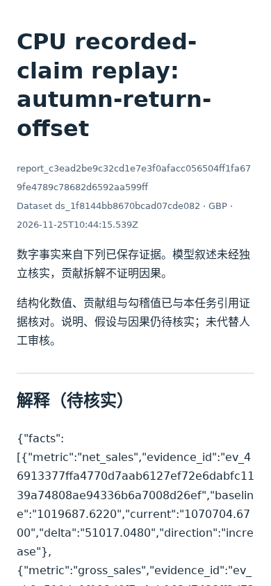

# 结构化声明封存前来源校验

这是宿主应用可靠性改动，Pi核心仍为contextlab.11。没有新增模型调用、没有重开或改写原实验；[原16请求研究](../structured-brief/)仍为full2/2、budgeted0/2。总已关闭真实生成请求保持105次。

- [固定回归方案](../../examples/brief-proof-replay-protocol.json)、[六次新旧执行结果](results.json)、[原声明输入](recorded-claims-input.json.gz)、[旧研究字节不变核对](closed-study-unchanged.json)。从三个已封存的历史声明体构造新隔离任务，输入正文/证据/假设相同，标题明确标CPU replay；缺报告的原实例没有伪造输入。
- 旧客户端接受三个；新版保留两个正确体，拒绝那个总增量冒充分组贡献、引用不存在商品的体。错误content JSON为389字节，未写报告/成功工具缓存。成功体得到绑定报告哈希的核对范围；原模型分数未变，不是准确率或纠正率实验。
- [95项Node测试](tests.tap)、[完整UCI核对](uci-validation.json)、[14项原工作台浏览器检查](browser-legacy.json)、[五个导出报告检查](browser-proof.json)。其中两个新版导出显示结构化字段已核对，三个旧版不显示；全部保持Unreviewed，移动端无横向溢出、无外部请求或JS错误。
- [执行源码包](source-snapshot.tar.gz)、[清单](snapshot-manifest.json)、[99个当前执行文件核对](source-verification.json)、[服务器lock](package-lock.json)、[阶段/资源/初期类型错误](runs/)。v1未使用导入、v2推断声明、v3JSON类型边界错误均保留，v4通过。整个任务78.839秒、最终owned0/GPU0。

来源检查发生在同一SQLite封存事务中：验证任务/期间/来源身份、比较值/方向、raw rows与展示结果/Top/OTHER/总额、国家/商品最大绝对变化组、勾稽及五个引用集合。并列及null组合法。失败不替换模型值、不提供正确答案；source-claims错误content最多2KiB。其他旧异常不属于该格式承诺。

成功记录只证明facts/priorities/check与本任务已保存来源一致，不是独立CSV oracle、原始数据真实性、完整自然语言任务覆盖或因果解释的证明。它不代替人工审核。旧报告不会追溯标记，新策略ID和旧缓存防护阻止静默切换。展示前再次核对记录与报告绑定，修改过的报告不展示该范围标记。

严格复现需单独检出并构建6bf2b5b的旧客户端，在本次源码/lock安装构建后运行：

```bash
node dist/scripts/probe-brief-proof.js \
  /path/to/frozen-v11/dist/src/brief-client.js \
  /path/to/readonly-datasets \
  /path/to/recorded-claims-input.json.gz \
  /path/to/fresh-replay-directory
```

源码包不嵌套历史模型结果，输入需显式提供并通过固定SHA校验。新旧均为实际Pi Agent/工具，只有脚本provider，没有HTTP模型重试、原任务重跑或新评分。新导出均为CPU回归报告，不当作新增真实模型报告。


